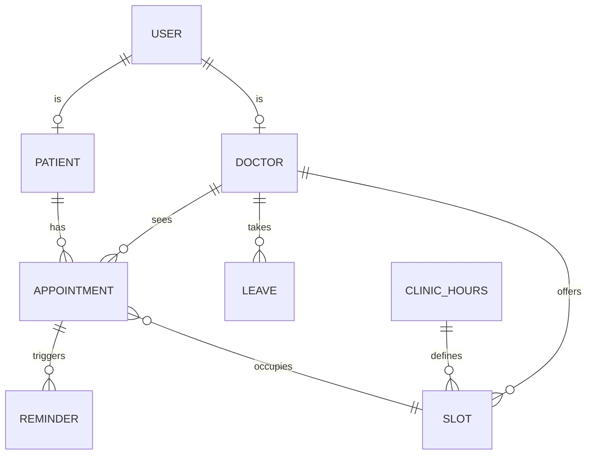

# 03 — Data and Rules

Values marked **(guessed)** are defaults to confirm in [07_decisions.md](07_decisions.md).

## Main objects

| Object | What it is | Key information |
|---|---|---|
| **User** | Anyone who signs in | email, password (stored scrambled), role (patient / receptionist / doctor) |
| **Patient** | A person who gets care | name, phone, email (optional for walk-ins), date of birth (optional), no-show count |
| **Doctor** | A clinician | name, speciality, visit length (default 20 min), linked user |
| **Clinic hours** | When the clinic is open | per weekday: open time, close time, lunch break (guessed 12:30–13:30); list of closed dates (holidays) |
| **Leave** | Doctor away | doctor, start date, end date, optional reason |
| **Slot** | A bookable time box | doctor, date, start time, length. Calculated from clinic hours minus leave minus lunch; not stored by hand |
| **Appointment** | A booking in a slot | patient, doctor, start, end, status, type (online / by phone / walk-in), reason, doctor note, who created it, created time, cancel reason |
| **Reminder** | A message to send | appointment, send time, channel (on-screen/email), sent yes/no |

## How they link

In words: a patient has many appointments; each appointment belongs to one doctor and sits in one slot; slots come from clinic hours minus leave.

## Appointment statuses
`Booked → Arrived → Done`, or `Booked → No-show`, or `Booked → Cancelled` (by patient / by clinic).
Only *Booked* and *Arrived* appointments block a slot.

## Business rules

### Time
1. **Slot length: 20 minutes** for every doctor (guessed). Longer visits are not in v1.
2. **Hours (guessed)**: Mon–Fri 09:00–17:00, lunch 12:30–13:30, Saturday and Sunday closed.
3. **Booking window**: from now up to **60 days** ahead (guessed). Never in the past; **at least 1 hour from now** for patients (guessed).
4. All times are in the clinic's own time zone.

### No clashes
5. A doctor can have **only one active appointment per slot**. Enforced at save time, not just on screen, so two simultaneous clicks cannot both win.
6. A patient cannot hold two active appointments at the same time (guessed).
7. A patient may have at most **3 upcoming** appointments (guessed).
8. Doctor on leave → no slots offered; closed date → no slots.
9. Exception: receptionist "Add as extra" may overbook, clearly tagged.

### Cancel / reschedule
10. **Cancel window: 2 hours** before start (guessed). Patients inside it must phone; receptionist can override and records a reason.
11. Reschedule follows the same window and is an atomic swap: old slot is released only if the new one is saved.
12. Cancelled slots are free again straight away.
13. Cancelled by clinic (leave): patient gets a notice and can rebook.

### No-show
14. Grace period **15 minutes** after start, then "Late?" tag (guessed).
15. No-show cannot be set before the start time.
16. 3 no-shows in 6 months → warning shown to receptionist only (guessed). No auto-block.

### Reminders
17. **24 hours before** and **2 hours before** (guessed). Skipped if the booking is made inside that window.
18. Cancelled/rescheduled bookings drop old reminders and create new ones.
19. v1 channel: email (phase 4); before that, reminders are only shown as a mock list.

### People and privacy
20. Patients see only their own bookings. Doctors see their own patients. Receptionists see all bookings but not doctor notes (guessed).
21. Passwords are never stored in plain form. Sessions expire after 8 hours of no use (guessed).
22. Keep data minimal: no diagnoses, no medical history in v1.
23. Appointments are never deleted, only given a status (keeps history).
