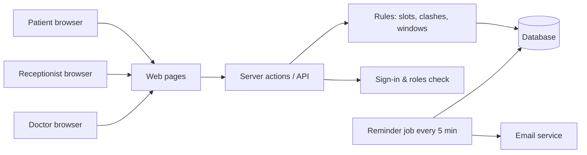

# 04 — Architecture

Choices are suggestions (**guessed**) for a small team and a small clinic: simple, cheap, easy to maintain.

## Stack
| Part | Choice | Why (one line) |
|---|---|---|
| Language | TypeScript | One language front and back; catches mistakes early |
| Web app | Next.js (React) | Pages, forms and server code in one project; mobile-friendly |
| Styling | Plain CSS / Tailwind | Fast to make clean, simple screens |
| Database | SQLite first, PostgreSQL if the clinic grows | SQLite needs no server; Postgres handles many users |
| Data access | Prisma | Readable data definitions, safe migrations |
| Sign-in | Email + password, cookie sessions (Auth.js) | Standard, secure, no custom crypto |
| Email | Resend or any SMTP | Cheap; used only for reminders |
| Reminders job | Small scheduled task (cron) | Checks every 5 minutes for reminders due |
| Tests | Vitest (logic) + Playwright (screens) | Covers rules and the real screens |
| Hosting | One small host (e.g., Fly.io / Render) | One app + one database file/volume, low cost |

## Folders (planned)
```
/docs                 these documents
/prototype            clickable look-and-feel (fake data)
/src
  /app                pages: /login /book /appointments /reception /doctor /admin
  /components         shared buttons, slot picker, calendar, dialogs
  /server
    /rules            booking rules in one place (slots, clashes, cancel window)
    /services         book, reschedule, cancel, walk-in, no-show
    /jobs             reminder sender
  /db                 schema, migrations, seed (fake demo data)
/tests                unit + end-to-end
```
Key idea: **all booking rules live in `/server/rules`**, not in screens, so the app can be tested without clicking.

## How the parts connect

Every server call checks **who you are and what your role may do** before touching data.

## Mocked vs stored
| Thing | Prototype | Phase 1–2 | Final |
|---|---|---|---|
| Patients, doctors, appointments | fake, in the page | stored in database | stored |
| Sign-in | fake role picker | real | real |
| Clinic hours, leave | fake | stored | stored |
| Reminders | text only | shown as "would send" list | real email |
| SMS | not planned | not planned | optional later (guessed) |
| Payments | none | none | none (out of scope) |
| Demo data | built-in | seed script | seed for demos only |

## Safety basics
- Clash check done **inside the database save** (unique doctor + start time among active bookings), so double-booking is impossible even with two clicks at once.
- Rate-limit sign-in attempts; scrambled passwords; HTTPS only.
- Daily database backup (phase 4).
