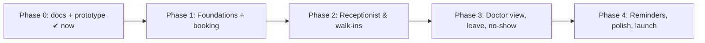

# 05 — Phases

Effort is a rough guess for one developer (**guessed**); "day" = a focused working day.

## Order of work

## Phase 1 — Foundations and patient booking
**Goal:** a patient can register, sign in, book, reschedule and cancel.
**Tasks**
1. Project setup, database, demo data (3 doctors, hours).
2. Sign-in, register, role routing.
3. Slot calculation from hours.
4. Booking, reschedule, cancel with clash protection.
5. Patient screens S1–S7.
6. Unit tests for the rules.
**You can open and judge:** a live demo site; register as a patient, book a slot, try to double-book from two windows, cancel.
**Effort:** 8–10 days.
**Risks:** double-booking bugs (mitigated by database-level check); time-zone mistakes (use one clinic time zone).

## Phase 2 — Receptionist tools
**Goal:** the receptionist can run the front desk.
**Tasks**
1. Day board S8 with all doctors.
2. Book for patient (by phone), patient search/new patient S13.
3. Walk-in S9 including "extra".
4. Override of cancel window with reason.
5. Arrived status.
**You can open and judge:** log in as receptionist and run a pretend morning: phone booking, walk-in, move, cancel.
**Effort:** 6–8 days.
**Risks:** board gets crowded with many doctors; duplicate patient records.

## Phase 3 — Doctor view, leave and no-shows
**Goal:** doctors work from the app; absences and no-shows handled.
**Tasks**
1. Doctor day view S11 and details S10, notes.
2. Done / No-show with grace period and undo.
3. Leave and clinic hours S12; list and cancel affected bookings.
4. No-show count warning.
**You can open and judge:** doctor login showing a realistic day; add leave and see bookings flagged.
**Effort:** 5–7 days.
**Risks:** leave added after bookings exist; privacy of notes (role checks).

## Phase 4 — Reminders, polish and launch
**Goal:** safe to use for real.
**Tasks**
1. Reminder job and real email.
2. Password reset.
3. Mobile layout pass, accessibility pass (text size, contrast).
4. Backups, error pages, deployment, basic monitoring.
5. Full test run and a pilot week with staff.
**You can open and judge:** the live address, a reminder email in your inbox, the whole flow on a phone.
**Effort:** 6–8 days.
**Risks:** email going to spam; legal/privacy requirements of your country (see decisions).

## Total
About **25–33 working days** (5–7 weeks) (guessed). Each phase ends with your approval before the next starts.
