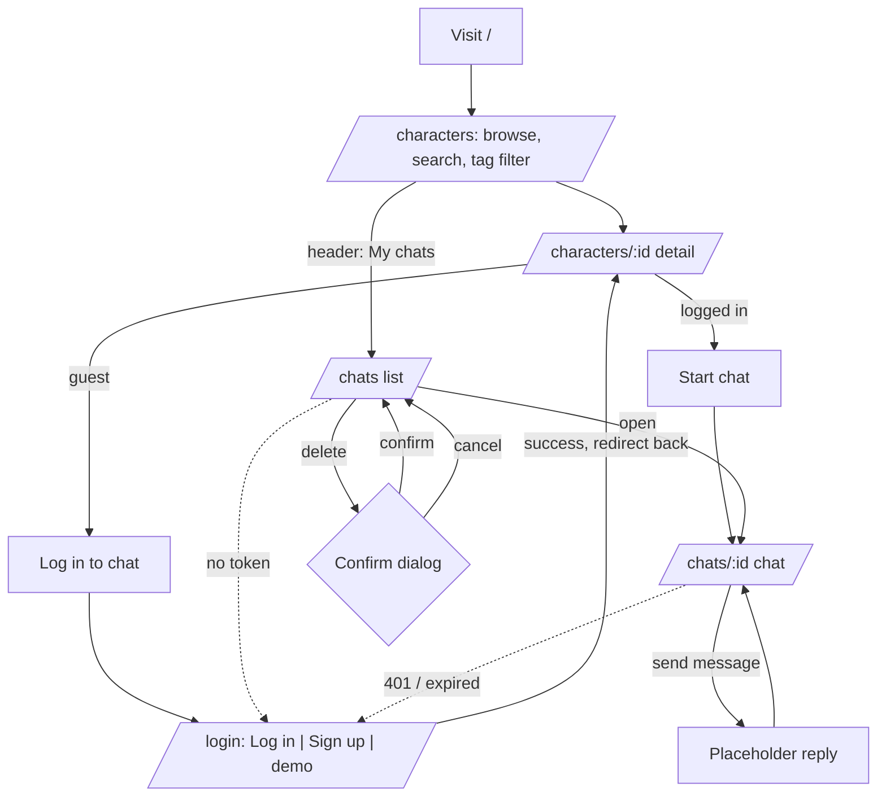
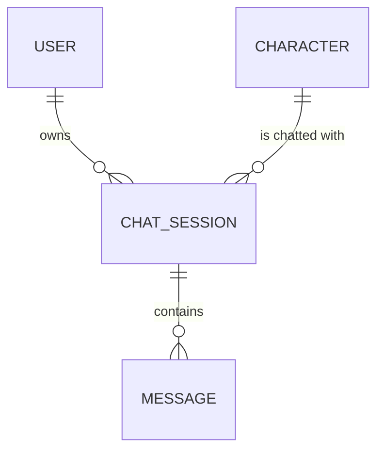

# Feature plan — AI Character Cards

## Scope

| Phase | Scope | Status |
|---|---|---|
| 1 – Foundation | FastAPI + SQLAlchemy 2 + Alembic (SQLite), JWT auth, seeded characters/demo user | ✅ done |
| 2 – UI (this PR) | Vue 3 SPA: browse, auth, start/continue/delete chats. Chat replies are **canned placeholders**, flagged by an "Under development" banner | ✅ done |
| 3 – Real chat | Plug an LLM into `app/services.py::stub_reply`, streaming replies, per-character system prompt | ⏳ next |
| 4 – Creators | Create/edit your own characters, avatars/images, public vs private | 💡 later |
| 5 – Polish | Pagination/search on server, rate limiting, refresh tokens, Postgres, CI, Docker | 💡 later |

**Out of scope for now:** payments, social features, moderation tooling, mobile apps.

## User flows

1. **Discover** (guest): `/characters` → search by name/tagline, filter by tag chip → card → `/characters/:id` (personality, greeting).
2. **Sign up / log in**: `/login` (tabs Log in / Sign up, "Use the demo account" shortcut). Protected pages redirect to login and return to the intended page afterwards. An expired token logs the user out and redirects.
3. **Start a chat**: character page → *Start chat* (guests see *Log in to chat*) → new session seeded with the character's greeting.
4. **Chat**: send a message → character's (placeholder) reply appears; the draft is kept on error.
5. **Manage chats**: `/chats` lists sessions (newest first, character, message count) → open, or delete with confirmation.
6. **Edge states** on every screen: loading, error + retry, empty ("No chats yet"), not found (character, chat, route).

## Components

`DevBanner`, `AppHeader`, `CharacterCard`, `TagChip`, `MessageBubble`, `StateBox` (loading/error/empty), `ConfirmDialog`.
Views: `LoginView`, `CharactersView`, `CharacterDetailView`, `ChatsView`, `ChatView`, `NotFoundView`.

## Backend structure

```
app/core      config (env), security (scrypt, JWT)
app/db        base (Base, UTCDateTime), session (engine), seed (idempotent)
app/models    User, Character, ChatSession, Message  (SQLAlchemy)
app/schemas   pydantic request/response models
app/api       routers: auth, characters, sessions (+deps)
app/services  placeholder chat engine
alembic/      migrations (0001 initial schema); applied automatically on startup
```

API lives under `/api`; the built SPA is served from `/` (with history-mode fallback).

## Flow diagram



## Entity relationships



## Wireframes

```
Characters (/characters)                     Character detail (/characters/:id)
+--------------------------------------+     +--------------------------------------+
| [UNDER DEVELOPMENT banner]           |     | [UNDER DEVELOPMENT banner]           |
| Character Cards  Characters MyChats  |     | Character Cards  Characters MyChats  |
|                       [Log in]/user  |     |--------------------------------------|
|--------------------------------------|     | < Back                               |
| [ Search...            ]             |     |  (emoji)  Captain Mira               |
| (all)(sci-fi)(fantasy)(noir)...      |     |  tagline                             |
| +--------+ +--------+ +--------+     |     |  personality: witty, loyal ...       |
| | emoji  | | emoji  | | emoji  |     |     |  "greeting..."                       |
| | name   | | name   | | name   |     |     |  [ Start chat ] / [Log in to chat]   |
| | tagline| | tagline| | tagline|     |     +--------------------------------------+
| +--------+ +--------+ +--------+     |
+--------------------------------------+
Chats (/chats)                               Chat (/chats/:id)
+--------------------------------------+     +--------------------------------------+
| Your chats                           |     | < Chats    Captain Mira       [Delete]|
| +----------------------------------+ |     |--------------------------------------|
| | emoji Captain Mira  3 msgs  [Del]| |     |  (char) Strap in, friend...          |
| | emoji Prof. Elm     1 msg   [Del]| |     |                  (you) Hello!        |
| +----------------------------------+ |     |  (char) placeholder reply            |
| empty: "No chats yet" [Browse]       |     |--------------------------------------|
+--------------------------------------+     | [ Type a message...        ] [Send]  |
                                             +--------------------------------------+
```
